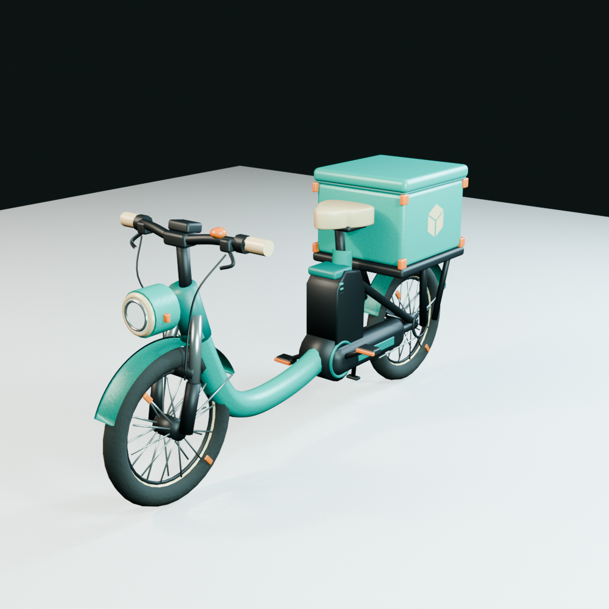

# Stylized game-asset experiments

[](https://github.com/ccycv/img2threejs-game-assets-experiment/actions/workflows/deploy-pages.yml)

An end-to-end experiment turning generated six-view concept sheets into procedural Three.js models, GLB exports, optimized Blender scenes, and validated Unity prefabs with [`img2threejs`](https://github.com/hoainho/img2threejs) v1.2.0.

**[Open the interactive gallery](https://ccycv.github.io/img2threejs-game-assets-experiment/)**

| Asset | Interactive demo | Prompt | Source factory |
| --- | --- | --- | --- |
| Delivery Cargo Bike | [Open viewer](https://ccycv.github.io/img2threejs-game-assets-experiment/bike/?view=three-quarter&pass=final) | [Six-view prompt](Assets/Concepts/DeliveryCargoBike_6View.prompt.md) | [`createDeliveryCargoBikeModel.ts`](ThreeJS/src/createDeliveryCargoBikeModel.ts) |
| Plaza Fountain | [Open viewer](https://ccycv.github.io/img2threejs-game-assets-experiment/fountain/?view=three-quarter&pass=final) | [Six-view prompt](Assets/Concepts/PlazaFountain_6View.prompt.md) | [`createPlazaFountainModel.ts`](ThreeJS/PlazaFountain/src/createPlazaFountainModel.ts) |



This workspace contains original game props derived from the supplied mobile-game visual language. Each asset follows the same production experiment: six-view concept, `hoainho/img2threejs` reconstruction, source GLB export, Blender optimization, and Unity prefab packaging.

## Asset 01 — Delivery Cargo Bike

Revision 2 is a close six-view matching pass. It replaces the blockout-like tire lugs and tubular mudguards, reshapes the saddle/battery/chain case, corrects the cargo latch and cube emblem, and adds the missing fork, rack, drivetrain, handlebar-control, cable, and lighting details.

- Six-view concept: `Assets/Concepts/DeliveryCargoBike_6View.png`
- Procedural reconstruction: `ThreeJS/src/createDeliveryCargoBikeModel.ts`
- Detailed comparison audit: `Pipeline/CargoBike/reference-audit-v2.md`
- Fixed browser views: `Previews/DeliveryCargoBike_v2_ThreeQuarter.png`, `Previews/DeliveryCargoBike_v2_Side.png`, and `Previews/DeliveryCargoBike_v2_Front.png`
- Source GLB: `Assets/DeliveryCargoBike.source.glb`
- Optimized Blender scene: `Blender/DeliveryCargoBike.optimized.blend`
- Optimized GLB: `Assets/DeliveryCargoBike.optimized.glb`
- Hero render: `Previews/DeliveryCargoBike_Blender.png`
- Unity prefab: `UnityProject/Assets/DeliveryCargoBike/Prefabs/DeliveryCargoBike.prefab`
- Validation: `UnityProject/Assets/DeliveryCargoBike/PrefabValidationReport.json`

| Bike gate | Result | Budget |
| --- | ---: | ---: |
| Source reconstruction | 34,488 triangles | 35,000 max |
| Blender/Unity optimized | 34,152 triangles | 35,000 max |
| Blender renderers | 10 | Functional-pivot consolidation |
| Unity colliders | 4 | 4 required |
| Missing interaction nodes | 0 | 0 required |

Rebuild the bike with `npm run build && npm run export:glb` from `ThreeJS`, then run `blender --background --python Pipeline/CargoBike/blender_optimize.py` from the repository root. The Unity prefab is regenerated in batch mode through `DeliveryCargoBikePrefabBuilder.BuildBatch`.

## Asset 02 — Plaza Fountain

The second asset is a 2.68 m wide, 2.18 m tall stylized tiered plaza fountain. Its v10 refinement keeps the corrected finial and physically segmented stonework while rebuilding all four fish spouts as compact sculpted masks with tapered crania, broad cheeks, short puckered mouths, lower jaws, eyes, brows, gills, fins, and dorsal crests. Thin runtime water arcs now begin exactly at the named mouth sockets and terminate in paired impact ripples.

### Deliverables

- Six-view concept: `Assets/Concepts/PlazaFountain_6View.png`
- Detailed v2 refinement target: `Assets/References/PlazaFountain_Target6View_v2.png`
- Exact generation prompt: `Assets/Concepts/PlazaFountain_6View.prompt.md`
- Asset specification: `Pipeline/PlazaFountain/asset-spec.json`
- Completed img2threejs sculpt specification: `Pipeline/PlazaFountain/object-sculpt-spec.json`
- Procedural Three.js reconstruction: `ThreeJS/PlazaFountain/src/createPlazaFountainModel.ts`
- Source GLB: `Assets/PlazaFountain.source.glb`
- Optimized Blender scene: `Blender/PlazaFountain.optimized.blend`
- Optimized GLBs: `Assets/PlazaFountain.optimized.glb`, `Assets/PlazaFountain.LOD1.glb`, and `Assets/PlazaFountain.LOD2.glb`
- Blender hero render: `Previews/PlazaFountain_Blender.png`
- V2 target/render comparison: `Pipeline/PlazaFountain/comparison-refinement-v2-blender.png`
- V3 water-flow and stone-joint comparison: `Pipeline/PlazaFountain/comparison-refinement-v3-water-joints.png`
- V4 target/render comparison: `Pipeline/PlazaFountain/comparison-refinement-v4-proportions-sculpt.png`
- V4 fixed browser views: `Previews/PlazaFountain_v4_Front.png`, `Previews/PlazaFountain_v4_Top.png`, and `Previews/PlazaFountain_v4_ThreeQuarter.png`
- V5 seam-contact comparison: `Pipeline/PlazaFountain/comparison-refinement-v5-seam-contact.png`
- V5 close low-angle seam proof: `Previews/PlazaFountain_v5_SeamClose.png`
- V6 physical-rim comparison: `Pipeline/PlazaFountain/comparison-refinement-v6-physical-rim-gaps.png`
- V6 close low-angle rim proof: `Previews/PlazaFountain_v6_SegmentedRimClose.png`
- V7 close finial proof: `Previews/PlazaFountain_v7_FinialClose.png`
- V7 upper-assembly context proof: `Previews/PlazaFountain_v7_UpperAssemblyClose.png`
- V8 opaque-collar three-quarter proof: `Previews/PlazaFountain_v8_UpperAssemblyClose.png`
- V8 opaque-collar front proof: `Previews/PlazaFountain_v8_FinialFront.png`
- V9 browser gameplay close proof: `Previews/PlazaFountain_v9_BrowserGameplayClose.png`
- V9 browser three-quarter proof: `Previews/PlazaFountain_v9_BrowserThreeQuarter.png`
- V9 browser top-occlusion proof: `Previews/PlazaFountain_v9_BrowserTop.png`
- V10 fish reference close-up: `Assets/References/PlazaFountain_FishHeadReferenceClose.png`
- V10 browser fish close-up: `Previews/PlazaFountain_v10_FishHeadClose.png`
- V10 browser fish views: `Previews/PlazaFountain_v10_FishFront.png`, `Previews/PlazaFountain_v10_FishSide.png`, and `Previews/PlazaFountain_v10_FishThreeQuarter.png`
- V10 optimized Blender fish close-up: `Previews/PlazaFountain_v10_FishBlenderClose.png`
- Unity FBX: `UnityProject/Assets/PlazaFountain/Models/PlazaFountain.fbx`
- Unity prefab: `UnityProject/Assets/PlazaFountain/Prefabs/PlazaFountain.prefab`
- Unity review scene: `UnityProject/Assets/PlazaFountain/Scenes/PlazaFountainReview.unity`
- Runtime socket rig: `UnityProject/Assets/PlazaFountain/Scripts/PlazaFountainRig.cs`

### Verified metrics

| Gate | Result | Budget |
| --- | ---: | ---: |
| Blender/Unity LOD0 | 21,600 triangles | 25,000 max |
| Blender/Unity LOD1 | 10,368 triangles | 12,000 max |
| Blender LOD2 | 3,455 triangles | 4,000 max |
| Unity-imported LOD2 | 3,361 triangles | 4,000 max |
| LOD0 materials | 5 | 5 max |
| LOD0 estimated draw calls | 8 | 8 max |
| Collider proxies | 3 | 3 required |
| Degenerate faces | 0 | 0 required |
| Loose vertices | 0 | 0 required |
| Missing Unity scripts | 0 | 0 required |

The Unity prefab uses a three-tier `LODGroup`, exposes lower/upper water sockets plus four radial spout sockets, retains upper-bowl and finial pivots, and includes an isolated review scene. Water jets are runtime effects and are deliberately excluded from the structural GLB/FBX geometry.

### Live fountain preview

```bash
cd ThreeJS/PlazaFountain
npm install
npm run dev -- --host 127.0.0.1 --port 5174
```

Open `http://127.0.0.1:5174/?view=three-quarter&pass=final`. Drag to orbit, scroll to zoom, and use `view=front`, `rear`, `side`, `top`, `grazing`, `gameplay`, or `three-quarter`.

### Rebuild fountain outputs

```bash
cd ThreeJS/PlazaFountain
npm run build
npm run export:glb
```

The Blender optimization recipe is retained in `Pipeline/PlazaFountain/blender_optimize.py`. The Unity prefab can be regenerated from `Tools > Game Assets > Build Plaza Fountain Prefab`, or in batch mode through `PlazaFountainPrefabBuilder.BuildBatch`.

### Fountain evidence

- `Pipeline/PlazaFountain/generation-receipt.json`
- `Pipeline/PlazaFountain/refinement-receipt-v2.json`
- `Pipeline/PlazaFountain/refinement-receipt-v3.json`
- `Pipeline/PlazaFountain/refinement-receipt-v4.json`
- `Pipeline/PlazaFountain/feature-reviews-refinement-v4.json`
- `Pipeline/PlazaFountain/refinement-receipt-v5.json`
- `Pipeline/PlazaFountain/feature-reviews-refinement-v5.json`
- `Pipeline/PlazaFountain/refinement-receipt-v6.json`
- `Pipeline/PlazaFountain/feature-reviews-refinement-v6.json`
- `Pipeline/PlazaFountain/refinement-receipt-v7.json`
- `Pipeline/PlazaFountain/feature-reviews-refinement-v7.json`
- `Pipeline/PlazaFountain/refinement-receipt-v8.json`
- `Pipeline/PlazaFountain/feature-reviews-refinement-v8.json`
- `Pipeline/PlazaFountain/refinement-receipt-v9.json`
- `Pipeline/PlazaFountain/feature-reviews-refinement-v9.json`
- `Pipeline/PlazaFountain/refinement-receipt-v10.json`
- `Pipeline/PlazaFountain/feature-reviews-refinement-v10.json`
- `Pipeline/PlazaFountain/concept-validation.json`
- `Pipeline/PlazaFountain/glb-export-report.json`
- `Pipeline/PlazaFountain/blender-optimization-report.json`
- `UnityProject/Assets/PlazaFountain/PrefabValidationReport.json`
- `Pipeline/PlazaFountain/unity-batch.log`

## Eligibility

Both assets remain `candidate-development-only`. The TypeScript build, real-browser visual gate, Blender close-angle review, optimized GLB re-import, and Unity Editor validation passed. Android/device performance and final in-game art-direction approval remain separate release gates.

## Licensing and reference provenance

- Source code is released under the [MIT License](LICENSE).
- Original generated concept images, renders, and exported 3D assets in this repository are released under [CC BY 4.0](ASSET_LICENSE.md), attributed to Cristian C (`ccycv`).
- The public repository deliberately excludes the third-party visual-language screenshot used privately for art-direction study. The published showcase reference is the original six-view concept generated for this experiment.
